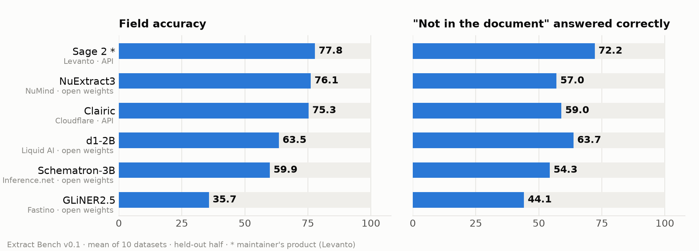
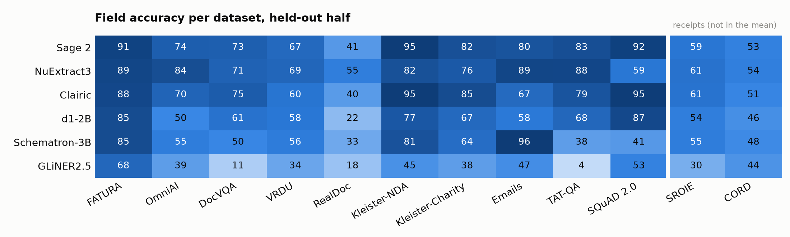

# Extract Bench

Extract Bench scores typed field extraction from real documents.

A system gets a document's text and a list of typed fields: text, number, money, date, duration or list. For each
field it returns a value, or null when the document doesn't contain one. Extract Bench compares every answer with
labels from 12 public datasets of invoices, receipts, forms, contracts, reports, emails and questions. Version 0.1 has
1,844 documents. `extract-bench report` reproduces in this README from the predictions in this repo.

<picture>
  <source media="(prefers-color-scheme: dark)" srcset="docs/images/leaderboard-dark.png">
  
</picture>

## Leaderboard (v0.1)

| # | System | By | Weights | Field accuracy | Δ vs Sage 2 [95% CI] | "Not in the document" correct |
|---:|---|---|---|---:|---|---:|
| 1 | Sage 2 (rc9 preview, fast) \* | Levanto | API | 77.8 | reference | 72.2 |
| 2 | NuExtract3 | NuMind | open (4B) | 76.1 | −1.7 [−4.3, +0.9] | 57.0 |
| 3 | Clairic | Cloudflare | API | 75.3 | −2.5 [−5.4, +0.2] | 59.0 |
| 4 | d1-2B | Liquid AI | open (2B) | 63.5 | −14.4 [−17.3, −11.1] | 63.7 |
| 5 | Schematron-3B | Inference.net | open (3B) | 59.9 | −17.9 [−21.1, −14.8] | 54.3 |
| 6 | GLiNER2.5 | Fastino | open (194M) | 35.7 | −42.1 [−45.4, −38.9] | 44.1 |

\* Levanto maintains this benchmark and sells Sage 2.

<picture>
  <source media="(prefers-color-scheme: dark)" srcset="docs/images/per-dataset-dark.png">
  
</picture>

<picture>
  <source media="(prefers-color-scheme: dark)" srcset="docs/images/sage2-vs-clairic-dark.png">
  
</picture>


## Datasets

| Dataset | What it tests | v0.1 eval / fit | Text the systems read | Data licence |
|---|---|---:|---|---|
| [FATURA](datasets/fatura/CARD.md) | Invoices (synthetic layouts, held-out templates) | 62 / 56 | Tesseract OCR | CC BY 4.0 |
| [OmniAI OCR](datasets/omniai/CARD.md) | Invoices, statements, checks, forms (vendor-built) | 95 / 84 | Azure Document Intelligence OCR | MIT (images are third-party) |
| [DocVQA](datasets/docvqa/CARD.md) | Reading one value off a scanned page | 145 / 133 | Official OCR | UNKNOWN at source |
| [VRDU](datasets/vrdu/CARD.md) | US FARA registration forms, ad-buy orders | 131 / 153 | Official OCR | UNKNOWN |
| [RealDoc](datasets/realdoc/CARD.md) | Mortgage, finance and medical forms (vendor-built) | 71 / 89 | Tesseract OCR | CC BY 4.0 labels; PDFs mixed |
| [Kleister-NDA](datasets/kleister_nda/CARD.md) | Contracts: date, jurisdiction, term, parties | 31 / 35 | PDF text layer | UNKNOWN |
| [Kleister-Charity](datasets/kleister_charity/CARD.md) | Charity annual reports | 44 / 35 | Official OCR (Textract) | UNKNOWN |
| [Emails](datasets/emails/CARD.md) | Which committee sent a fundraising email | 45 / 35 | Native | MIT |
| [TAT-QA](datasets/tatqa/CARD.md) | Values from financial tables and text | 24 / 42 | Native | CC BY 4.0 |
| [SQuAD 2.0](datasets/squad2/CARD.md) | Questions that may have no answer | 57 / 39 | Native | CC BY-SA 4.0 |
| [SROIE](datasets/sroie/CARD.md) (receipts) | Scanned receipts | 143 / 135 | Tesseract OCR | CC BY 4.0 (claimed by a mirror) |
| [CORD](datasets/cord/CARD.md) (receipts) | Receipt photos | 79 / 81 | Tesseract OCR | CC BY 4.0 |

Each dataset's `CARD.md` records the source and pinned revision, checksums, licence evidence, how we mapped fields and
audited gold, and published baselines. Each `build.py` rebuilds the set deterministically. The repo ships `items.jsonl`
(text and gold) and the OCR text, so text-input runs need no OCR and no downloads. It doesn't ship page images; each
`build.py` can fetch them from the source. [LICENSE-DATA.md](LICENSE-DATA.md) gives the licence status of every set.


## Raw outputs

[`results/v0.1/<system>/preds/`](results/v0.1) holds every prediction behind the leaderboard, one JSON line per
document with the system's own answer for each field. Here is one invoice:


`python scripts/render_examples.py` regenerates this table, and [`docs/examples/`](docs/examples) has the same page as
HTML. It shows two kinds of error. The OCR read "INV/55" as "INVI55", so all five systems got the invoice number wrong.
The invoice prints no subtotal, and three systems invented one anyway.

This is the leaderboard as the CLI prints it:


This is the check to run before a pull request:


## Quickstart

```sh
git clone <this repo> && cd extract-bench
uv venv && uv pip install -e ".[dev]" && source .venv/bin/activate   # or plain venv + pip

extract-bench datasets      # list the 12 datasets and the v0.1 split
extract-bench report        # re-score results/v0.1/ and print the leaderboard (offline, about 10 s)
pytest -q                   # run the 121 offline tests
```

Runs are mock runs unless you ask for live calls. A mock run makes no network calls, needs no keys, and its name must
start with `dryrun-`:

```sh
extract-bench run read  --run dryrun-demo --datasets emails --arms clairic_text,sage_fast --limit 5
extract-bench run score --run dryrun-demo --datasets emails --pair clairic_text sage_fast
```

A live run needs your keys in the environment (see [`.env.example`](.env.example)), `EXB_LIVE=1`, and a spend cap in
`EXB_CAP_USD`. The runner appends every live call to `runs/_ledger.jsonl` and stops at the cap.

```sh
EXB_LIVE=1 EXB_CAP_USD=5 extract-bench run read --live --run my-run --arms clairic_text --datasets kleister_nda
```

Open-weight models run on any CUDA GPU. `extract-bench open export` builds the requests on your machine, and the GPU
only runs inference:

```sh
extract-bench open export --out reqs/
python -m extract_bench.pod.infer_open nuextract3 reqs/nuextract3.jsonl out/nuextract3.results.jsonl   # on the GPU
extract-bench open import --run my-open-run --results out/
```

## Add your system

1. Write `results/v0.1/<your-system>/metadata.json` and `preds/<dataset>.jsonl`. You can add an adapter to
   `src/extract_bench/clients.py` and use `extract-bench run`, or write the files from your own pipeline in the format
   that [SUBMITTING.md](SUBMITTING.md) describes.
2. Run `extract-bench validate results/v0.1/<your-system>`.
3. Open a pull request. CI re-scores your predictions. The row stays marked as self-reported until a maintainer
   reproduces it.

## How scoring works

This is the short version. [docs/METHODOLOGY.md](docs/METHODOLOGY.md) has the details.

1. Every system reads the same text: native text, the dataset's official OCR, or one shared Tesseract pass. Every
   system gets the same field definitions, in its own request format. Sage 2 and Clairic take typed fields, NuExtract3
   takes a JSON template, Schematron takes a JSON Schema, GLiNER2.5 takes entity labels, and d1-2B takes one typed read
   question per field.
2. An answer is correct when it matches the gold after normalising for its type. The scorer converts dates to ISO,
   compares money in cents, parses numbers, and NFKC-normalises and case-folds text. Under rule (a), a null answer
   is correct when the gold is empty, so leaving a field blank is a real answer. DocVQA uses ANLS, SQuAD uses token F1
   and TAT-QA uses a numeric tolerance, as their original benchmarks do.
3. An answer that doesn't parse scores 0 on every field. A request that errors removes that document from the
   comparison for every system.
4. The score is field accuracy per dataset, averaged over datasets, on the eval half only. Levanto fitted Sage 2's
   abstention thresholds on the other half.
5. Each interval comes from an item-paired bootstrap with 2,000 resamples and seed 20. The interval on the mean
   resamples items within each dataset.

## Repository layout

```
datasets/<key>/      CARD.md, build.py, items.jsonl, ocr/ (the text systems read), comparable/ (official scorers)
splits/v0.1.json     the 1,844 items of v0.1 and their eval / fit half
results/v0.1/        one directory per system (metadata.json, preds/<dataset>.jsonl), plus the generated board.json / board.md
src/extract_bench/   the package: run (pipeline stages), clients (adapters), score, report, validate, open (GPU models)
scripts/             make_figures.py, render_examples.py, check_secrets.py
docs/                METHODOLOGY.md, ADAPTERS.md, images/, examples/
tests/               offline tests of the scorer, mock-mode adapters, report, validator and baseline answers
```

## Licence

The code is under [Apache-2.0](LICENSE). Each dataset keeps its own licence, and [LICENSE-DATA.md](LICENSE-DATA.md)
lists them, including the sets whose redistribution terms are still UNKNOWN.
